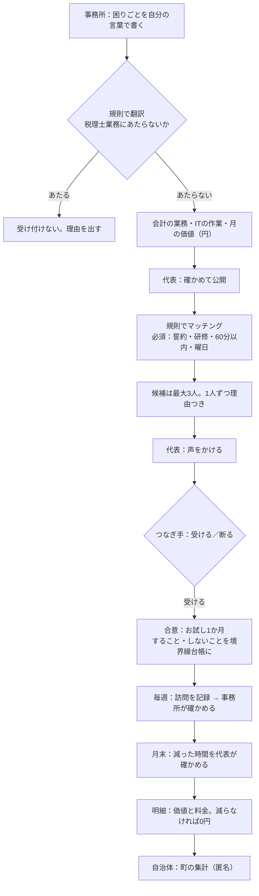

# 01｜要件定義書 — つなぐだけ（Tsunagudake）

版2.0・2026-11-19。作成：丹内 智弥。
食い違いがあるときは 01 → 02 → 03 の順で正とする。権限だけは [authorization.md](authorization.md) が正本。

- 技術の決まり → [02 技術仕様書](02-technical-spec.md)
- テーブル・規則・画面・テスト・作る順番 → [03 詳細設計書](03-detailed-design.md)
- 公開の手順 → [runbook.md](runbook.md)
- 姉妹アプリ → [撮って送るだけ帳簿（torudake）](https://github.com/TannaiTomoya/torudake-app)

---

## 0. この版で変えたこと

| 項目 | 版1.0 | 版2.0 | 理由 |
|---|---|---|---|
| 発表で見せるもの | Streamlit の4画面（別物のデモ） | **本番と同じアプリ**を `APP_ENV=demo` で動かす | 見せたものが、そのまま使われるものになる。作り直しをなくす |
| フレームワーク | Django | **Flask**（＋ Flask-Login・Flask-WTF・Flask-SQLAlchemy・Flask-Migrate） | キャンプで学んだ型と、公開の手順がそのまま使える（02 §2） |
| 公開 | 未定 | VPS（Ubuntu 24.04）＋ nginx ＋ gunicorn ＋ MySQL ＋ HTTPS | [runbook.md](runbook.md) |
| 会員登録 | 招待制 | 招待制のまま。**発表までは運営がコマンドで作る**（画面は発表のあと） | 一本道を先に通す |
| 2段階認証 | 最初から必須 | **実際の事務所が使う前に必須**（発表は架空のデータだけ） | 同上 |
| 簿記の合格証 | 画像を預かり90日で消す | **画像を預からない**。運営が目で確かめ、確かめた記録だけを残す | 置かないものは漏れない |
| 聞き取りの書き方 | 発言の引用と数字 | 分かったことだけを書く | このリポジトリは公開。発言と、個人が分かる数字は置かない |
| 進め方 | S0〜S3 | 段階0〜9（P0）と、P1・P2 | Issue と1対1にする（03 §12） |

## 1. 原点と目的

**原点は、母のため。** 家業の経理は、母が担ってきた。真面目に記録する人ほど、言った・言わないの中で割を食う。
人の言葉は揺れる。記録は揺れない。だから、**記録で、真面目な人が損をしない境界線を引く。**

- 撮って送るだけ帳簿（torudake）は、**会社の中**で経理の人を守る（現場の証憑を、撮って送るだけで記録にする）。
- つなぐだけ（Tsunagudake）は、**会社の外**で経理の人を支える人をつなぐ（会計事務所に、会計とITの両方がわかる人を入れる）。

2つは同じ思想でできている。**記録が人を守る。判断は人がする。**

> **目的：地方の会計事務所に、会計とITの両方がわかる人を週1回入れて、税理士を「判断するだけ」にする。**

| 誰の | 何を |
|---|---|
| 会計事務所（税理士） | チェックと資料集めの時間を減らし、判断と顧問先の相談に時間を戻す |
| 顧問先の現場の経理（母のような人） | 資料を出す手間と、言った・言わないの負担を減らす |
| 会計とITを学んだ人（つなぎ手） | 地方で腕を使い、信用を積む場所を得る |
| 自治体 | 町の会社の数字を預かる場所（会計事務所）が楽になり、人が町に入る入口ができる |

税務の判断・申告は税理士の仕事（税理士法 第52条）。このアプリが扱うのは、**その手前と後ろの「作業の仕組み化」**と、**それを担う人の信用**だけ。

## 2. 聞き取りで分かったことと、設計

2026年11月に3名（公認会計士・税理士・地域で起業したプログラミング講師）から聞いた。**聞けたのは現象まで。** 原因と支払いの意思は §12.2 で確かめる。

| 分かったこと | 聞いた相手 | 設計への当て方 |
|---|---|---|
| 会計・税務の人とITの人は、使う言葉が違う | 公認会計士 | **F10 困りごとの翻訳**（事務所の言葉 → 会計の業務 → ITの作業）。つなぐ条件に「会計の言葉が通じること（簿記の級）」 |
| 記帳は連携でほぼ自動になった。残る手間は、資料が集まるまでと、入力のあとのチェック・過去との比較 | 税理士 | 困りごとの型の中心を「資料回収」「チェックと比較」に置く。F45 過去比較 |
| 資料集めを手作業でやっている事務所は、まだ多い | 税理士 | 最初の利用者は、**手作業が残る地方の事務所** |
| 外に頼むと高い。できあがるものが合うかも分からない | 税理士 | **F40 減らなければ0円**。料金は、事務所が確かめた減った時間から計算する |
| 決めるのは代表 | 税理士 | 公開・合意・確定は**代表だけ** |
| 入る人には、守秘とセキュリティの最低限の理解が要る | 税理士 | **守秘の誓約と研修を必須**に（1年ごとに更新）。顧問先の生データはアプリに置かない |
| よそから来た人が信用されるのは、決まった時間にそこにいるから | 講師 | つなぐ条件に「**毎週、決まった曜日に通える**」。F30 訪問の記録 |
| AI を入れても、説明と落とし所は人の仕事 | 公認会計士 | AI は候補まで。**決めるのは人** |

## 3. 利用者とロール

| 人 | ロール | やること | やらないこと |
|---|---|---|---|
| 会計事務所の代表（税理士） | `office`／所属 `owner` | 困りごとを書く・公開・候補に声をかける・合意・訪問と減った時間を確かめる・明細を確定 | 税務の判断をアプリに任せない |
| 会計事務所の職員 | `office`／所属 `staff` | 困りごとを書く・訪問を確かめる | 公開・合意・確定 |
| つなぎ手 | `tsunagite` | 信用台帳を整える・声かけに答える・週1回の訪問を記録 | **税理士業務（税務代理・税務書類の作成・税務相談）**。顧問先の生データの持ち出し |
| 自治体の担当 | `municipality` | 自分の市町村の集計（匿名）を見る | 個々の事務所・人のデータを見ない |
| 運営（作者） | `admin` | アカウントを作る・簿記の級を確かめる・止める・台帳を検証 | 顧問先のデータを見ない。事務所の困りごとの本文を黙って読まない（読んだら監査記録に残る） |
| 顧問先の現場の経理 | （利用者ではない） | 撮って送るだけ帳簿で証憑を送る（F50） | — |

## 4. ユーザーストーリー

| ID | 誰が | 何をしたい | 機能 |
|---|---|---|---|
| O1 | 代表 | 困りごとを自分の言葉で書くだけで、何を頼めばよいかが分かる | F10・F11 |
| O2 | 代表 | 頼む前に、月いくらの価値がある話なのかを知りたい | F12 |
| O3 | 代表 | 言葉が通じて、毎週通える人だけを、理由つきで見たい | F25・F26 |
| O4 | 代表 | 合わなければ断れる。成果が出なければ払わない | F27・F28・F40 |
| O5 | 代表・職員 | 来た日と、やったことを、1分で確かめたい | F30 |
| O6 | 代表 | 月末に、減った時間と料金を自分で確かめて決めたい | F31・F41・F42 |
| T1 | つなぎ手 | 自分の級・道具・通える曜日を一度入れれば、合う事務所から声がかかる | F20・F27 |
| T2 | つなぎ手 | 何をして、何をしないかを、最初に記録に残したい | F32・F33 |
| T3 | つなぎ手 | やったことが、あとから「言っていない」にならない | F30・F32 |
| M1 | 自治体 | 町で何が起きているかを、個別の事務所を見ずに数字で知りたい | F55 |
| A1 | 運営 | 級を確かめた人だけを候補に出したい | F23 |
| A2 | 運営 | 記録が書き換えられていないことを、いつでも確かめたい | F34 |
| D1 | 発表を聞く人 | 自分のスマホで開いて、3つの立場を触って確かめたい | F60〜F62 |

## 5. 業務の流れ

| いつ | 誰 | やること | 目安 |
|---|---|---|---|
| 最初の1回 | 代表 | 困りごとを書いて公開 | 10分 |
| 最初の1回 | 代表・つなぎ手 | 顔合わせ（アプリの外）→ 合意 | 30分 |
| 毎週 | つなぎ手 | 訪問・作業・記録 | 半日 |
| 毎週 | 職員または代表 | 訪問の記録を確かめる | 1分 |
| 月1回 | 代表 | 減った時間と明細を確定 | 3分 |

## 6. 機能要件

優先度：**P0**＝2026-11-22 の発表で動かす／**P1**＝発表までにあると良い／**P2**＝発表のあと。段階は 03 §12。

### 6.1 認証・権限・記録
| # | 機能 | 対象 | 優先度 | 段階 |
|---|---|---|---|---|
| F01 | ログイン・ログアウト。パスワードはハッシュで保存。パスワードを変えると、前のログイン状態はすべて切れる | 全員 | P0 | 3 |
| F02 | ロールと所属による画面の制限。**他の事務所のものは404**、ロールの不足は403（[authorization.md](authorization.md)） | 全員 | P0 | 3 |
| F03 | 会員登録は招待制。発表までは運営が `flask create-user` で作る。招待リンクの画面はあと | 運営 | P0（コマンド）／P2（画面） | 3／16 |
| F04 | パスワード再設定（期限つき・1回限りのリンク。登録の有無を画面で明かさない） | 全員 | P2 | 16 |
| F05 | 2段階認証（TOTP）。**実際の事務所が使う前に必須** | 全員 | P2 | 17 |
| F06 | 回数制限（同じメールアドレスへの失敗15分に5回で止める、など） | システム | P1 | 12 |
| F07 | 監査記録（ログイン・公開・声かけ・合意・確認・確定・運営の閲覧）。画面はあと | システム | P0（記録）／P2（画面） | 3 |

### 6.2 困りごと
| # | 機能 | 対象 | 優先度 | 段階 |
|---|---|---|---|---|
| F10 | **困りごとの翻訳**：自分の言葉で書く → 会計の業務（6つの型）と ITの作業に訳す。どの言葉で判断したかを出す。**同じ文章なら必ず同じ答え** | 代表・職員 | P0 | 2・4 |
| F11 | **税理士業務の見分け**：税務代理・税務書類の作成・税務相談にあたりそうなら公開させず、理由を出す | システム | P0 | 2・4 |
| F12 | **価値の見積もり**：月の時間 × 事務所の時給（既定4,000円）＝月の価値。減らせる見込みは3段（少なめ・真ん中・多め） | 代表 | P0 | 2・4 |
| F13 | 公開・取り下げ（代表だけ） | 代表 | P0 | 4 |

### 6.3 つなぎ手と信用台帳
| # | 機能 | 対象 | 優先度 | 段階 |
|---|---|---|---|---|
| F20 | プロフィール：簿記の級・使える道具・住む市町村・通える曜日・所属（修了生・協力隊など）・受け持ちの上限 | つなぎ手 | P0（表示。データは seed）／P1（編集） | 5／13 |
| F21 | **必須の守り**：守秘の誓約と研修。どちらも1年で期限切れ。切れた人は候補に出ない | つなぎ手 | P0（期限の判定）／P1（署名の画面） | 5／13 |
| F22 | 実績：事務所が確かめた訪問回数と減った時間の合計（自己申告は数えない） | システム | P0 | 5 |
| F23 | 運営の確認：合格証を目で見て、確かめた日と人を記録する。**画像は預からない** | 運営 | P1 | 13 |

### 6.4 マッチングと合意
| # | 機能 | 対象 | 優先度 | 段階 |
|---|---|---|---|---|
| F25 | **規則でマッチング**：必須条件を満たす人だけを点数で並べ、**上位3人** | システム | P0 | 2・6 |
| F26 | **理由の表示**：「簿記2級：会計の言葉が通じる」「車で25分：毎週火曜に通える」 | 代表・職員 | P0 | 6 |
| F27 | 声をかける（代表）→ 受ける／断る（つなぎ手）。**選ぶのは人。システムは決めない** | 代表・つなぎ手 | P0 | 6 |
| F28 | 合意：お試し1か月。曜日・時給・料金の割合・上限・「しないこと」を決めて始める | 代表・つなぎ手 | P0 | 6 |

### 6.5 伴走と境界線台帳
| # | 機能 | 対象 | 優先度 | 段階 |
|---|---|---|---|---|
| F30 | 訪問の記録（日付・時間・作業の型・メモ）。事務所が「確かめた」を押すと書き換えられなくなる | つなぎ手・事務所 | P0 | 7 |
| F31 | 減った時間：作業の型ごとに「前」と「今」。**代表が確かめたものだけが成果** | 代表 | P0 | 7 |
| F32 | **境界線台帳**：依頼・合意・変更・完了・指摘を追記だけで残す。前の行のハッシュをつなぎ、書き換えが見つかる | システム | P0 | 2・6 |
| F33 | 「しないこと」：税理士業務と、顧問先の生データの持ち出しは、合意のたびに必ず入る（外せない） | システム | P0 | 6 |
| F34 | 台帳の検証：`flask verify-ledger` と、運営の画面の「確かめる」 | 運営 | P0（コマンド）／P2（毎日） | 6／22 |

### 6.6 成果と料金
| # | 機能 | 対象 | 優先度 | 段階 |
|---|---|---|---|---|
| F40 | **減らなければ0円**：確かめた減った時間が0なら、料金は0円 | システム | P0 | 2・7 |
| F41 | **料金＝価値の一部**：減った時間 × 時給 ＝ 価値。料金はその一定割合（既定40%、**半分を超えない**）。上限は合意で決める | システム | P0 | 2・7 |
| F42 | 月の明細の確定（代表だけ）。**アプリは決済しない・お金を預からない**（支払いは振込。請求書の出力はあと） | 代表 | P0（確定）／P2（請求書） | 7 |

### 6.7 道具・連携・地域
| # | 機能 | 対象 | 優先度 | 段階 |
|---|---|---|---|---|
| F45 | 過去比較チェック：事務所のPCで動く。試算表（今期と過去3期）から、幅を外れた科目に印。**アプリに送るのは件数だけ** | つなぎ手 | P2 | 18 |
| F46 | 資料回収ボード（顧問先ごとの、そろった・まだ） | 事務所 | P2 | 19 |
| F50 | 撮って送るだけ帳簿との連携（届いた件数だけ） | 事務所 | P2 | 19 |
| F55 | **地域のダッシュボード**：参加事務所・つなぎ手（うち協力隊など）・訪問回数・確かめた減った時間。**匿名。5件未満は伏せる** | 自治体 | P0 | 2・8 |

### 6.8 デモ・運用
| # | 機能 | 対象 | 優先度 | 段階 |
|---|---|---|---|---|
| F60 | デモ環境（`APP_ENV=demo`）：全画面の上に「発表用のデモです。データはすべて架空です。本物の情報を入力しないでください」 | 全員 | P0 | 9 |
| F61 | `flask seed-demo`（架空のデータを入れる）／`flask reset-demo --yes`（消して入れ直す）。demo と development でだけ動く | 運営 | P0 | 9 |
| F62 | **デモで入る**：「会計事務所として見る」「つなぎ手として見る」「自治体として見る」をボタン1つで。demo と development でだけ動く | 発表を聞く人 | P0 | 9 |
| F65 | 動作の確認用の `/healthz`（DB につながるか） | システム | P0 | 0 |
| F66 | 毎日のバックアップ（サーバーの中と外）と、復元の練習 | 運営 | P1 | 10 |
| F67 | 自動デプロイ（main に入ると、検査のあと本番に反映。反映の前に DB をバックアップ） | 運営 | P1 | 11 |
| F70 | 通知メール（声かけ・合意・確認待ち） | 全員 | P2 | 16 |
| F80 | 退会と削除（03 §9） | 運営 | P2 | 23 |
| F90 | 開発用の MCP サーバー（読み取り専用。手元の DB だけ） | 開発者 | P2 | 21 |
| F91 | AI による翻訳の候補（規則で訳せなかったときだけ。名前と金額は伏せて送る） | 代表 | P2 | 20 |

### 6.9 作らないもの
税務の判断・申告書の作成・税務相談、顧問先の帳簿データの保管、決済・お金の預かり、給与の支払い、人の雇用・派遣、スマホの専用アプリ、AI によるマッチングの確定、点数だけで人を並べる公開のランキング。

## 7. 画面一覧

| 画面 | パス | 見られる人 |
|---|---|---|
| トップ（一言・しくみ・デモで入る） | `/` | 全員 |
| しくみ（規則の中身を全部見せる） | `/how` | 全員 |
| ログイン | `/login` | 未ログイン |
| 事務所のホーム | `/o/<office_id>/` | その事務所の人 |
| 困りごとを書く／見る（翻訳・価値・公開） | `/o/<office_id>/needs/new`・`/needs/<id>` | その事務所の人 |
| 候補3人と理由／声をかける | `/o/<office_id>/needs/<id>/candidates` | その事務所の人（声かけは代表） |
| 伴走（訪問・減った時間・明細・境界線台帳） | `/o/<office_id>/engagements/<id>` | その事務所の人 |
| つなぎ手のホーム（信用台帳・声かけ・伴走） | `/t/` | 本人 |
| 訪問を記録する | `/t/engagements/<id>/visits/new` | その伴走のつなぎ手 |
| 地域のダッシュボード | `/r/<municipality_code>/` | その市町村の担当・運営 |
| 運営（人・級の確認・台帳の検証） | `/admin/…` | 運営 |
| 動作の確認 | `/healthz` | 全員（中身は `ok` だけ） |

## 8. 非機能要件

| 分類 | 要件 |
|---|---|
| 安全 | パスワードはハッシュ。全フォームに CSRF 対策。Cookie は Secure・HttpOnly・SameSite=Lax。許可した Host 以外は拒否。HTTPS だけ。秘密は `.env`（Git に入れない） |
| 権限 | 判定はサーバー側。入口すべて（表示・保存・一覧）に入れる。権限表の拒否のマス1つにつき、テスト1本（[authorization.md](authorization.md)） |
| 個人情報 | 持つのは、メールアドレス・表示名・市町村・簿記の級まで。住所・電話・合格証の画像・顧問先のデータは持たない。IP アドレスはハッシュにして保存 |
| 再現性 | 翻訳・マッチング・料金は、**同じ入力なら必ず同じ答え**。規則の版と入力のハッシュを残す |
| 記録 | 境界線台帳は追記だけ。確かめたあとの訪問・確定したあとの明細は書き換えない（直すときは台帳に「指摘」） |
| 使いやすさ | 本文16px以上、文字と背景のコントラスト4.5以上、スマホの幅で崩れない、Tab キーで今いる所が見える。空・長い文字・エラーの状態を作る（02 §8） |
| 続けられること | VPS を再起動しても自動で立ち上がる。バックアップは毎日、サーバーの中と外。**失ってよいのは最大24時間分**（発表のあと、実際の事務所が使う前に見直す） |
| 検査 | コミットの前に、整形・静的解析・全テスト。公開の前に MySQL で全テスト（02 §10） |
| 置き場所 | 実在の事務所・人・数字は、リポジトリ・テスト・デモのデータに入れない。架空だけ |

## 9. データと法律

### 9.1 データの決まり
| もの | 決まり |
|---|---|
| 顧問先の生データ（仕訳・試算表・個人名・金額の明細） | **アプリに置かない。** 過去比較（F45）は事務所のPCで動き、件数だけを返す |
| 事務所のデータ | 困りごと・時間・明細・境界線台帳。事務所ごとに分け、他の事務所からは存在も見えない |
| 困りごとの本文 | 自治体・他の事務所・つなぎ手（声をかけられる前）には出さない |
| 自治体に見せるもの | 匿名の集計だけ。5件未満は伏せる |
| AI に送るもの | 規則で訳せなかった困りごとの文章だけ（名前・金額を伏せてから）。既定は AI を使わない |
| 金額 | 円の整数。割合は万分率の整数 |

### 9.2 守り（真面目な人が損をしないために）
1. **人ではなく、仕組みを信用する**：成果は事務所が確かめた数字だけ。料金は規則で計算。記録は書き換えられない
2. **言った・言わないを残さない**：依頼・合意・変更・完了・指摘は、すべて境界線台帳に
3. **決めるのは人**：翻訳は候補まで。マッチングは候補まで。確定は代表
4. **信用は更新する**：誓約と研修は1年ごと。切れたら候補に出ない

### 9.3 法律（実際の事務所が使う前に、専門家に確かめる）
| 法律 | 心配 | 当面の形 |
|---|---|---|
| 税理士法 第52条（税理士業務の制限） | つなぎ手が税務代理・書類作成・相談をしてしまう | F11 で入口を止め、F33 で「しない」に固定。作業は、税理士の指示の下の事務作業と仕組み化に限る |
| 税理士法 第38条・第54条（秘密を守る義務） | 顧問先の秘密が漏れる | F21 の誓約と研修。生データはアプリに置かない |
| 職業安定法（有料職業紹介の許可） | 人の紹介で手数料を取ると、許可が要る場合がある | 運営は**業務委託の取次ぎと道具の提供**にとどめ、雇用の紹介はしない |
| 労働者派遣法・偽装請負 | 事務所が日々の指揮命令をすると、派遣とみなされる場合がある | 合意で範囲を決め（F33）、日々の指揮命令をしない形にする |
| フリーランス法（取引条件の明示・報酬の支払期日など） | 「減らなければ0円」が、つなぎ手のただ働きになる | **0円はお試しの1か月だけ**に限る案。協力隊の活動として入る人と、個人で請ける人で分ける（§12.2 Q8） |
| 個人情報保護法 | つなぎ手・事務所の人の情報 | 持つ項目を最小に（§8）。利用目的とプライバシーポリシーは公開前に作る |

## 10. 完成の基準

| # | 基準 | 優先度 |
|---|---|---|
| AC01 | 困りごとの文章から、会計の業務とITの作業が、根拠の言葉つきで出る。同じ文章なら必ず同じ答え | P0 |
| AC02 | 税務相談・申告書の作成にあたる文章は公開できず、理由が出る | P0 |
| AC03 | 誓約・研修が切れた人、60分を超える人、曜日が合わない人は、候補に出ない | P0 |
| AC04 | 候補は最大3人で、1人ずつ理由が出る。同じ入力なら同じ順番 | P0 |
| AC05 | 減った時間が0なら0円。料金は価値の半分を超えない | P0 |
| AC06 | 他の事務所の困りごと・候補・伴走・明細は404。一覧にも出ない | P0 |
| AC07 | 公開・声かけ・合意・確定は代表だけ。職員は403 | P0 |
| AC08 | 合意すると、境界線台帳に「しないこと」が入った行が増える。行を書き換えると、検証で見つかる | P0 |
| AC09 | 地域のダッシュボードは匿名で、5件未満は伏せる。事務所名・人名が画面のどこにも出ない | P0 |
| AC10 | demo 以外では、デモで入る・seed-demo・reset-demo が動かない | P0 |
| AC11 | 本番の設定が足りないとき（鍵が空、SQLite、http）は、起動しない | P0 |
| AC12 | 発表の台本（§11）を、公開した URL で、スマホから通せる | P0 |
| AC13 | バックアップから別の DB に戻し、件数が合う | P1 |
| AC14 | 過去比較は、顧問先のデータを送らず、件数だけを返す | P2 |

## 11. 発表の台本と、伝え方

デモは約90秒。**数字と名前はすべて架空。**

| 時間 | 立場 | 場面 | 画面 |
|---|---|---|---|
| 0:00 | 会計事務所 | 困りごとを書く：「顧問先の資料が月末まで集まらない。試算表を過去と見比べるのに、毎月30時間かかる」 | 困りごと |
| 0:15 | 会計事務所 | 翻訳：「資料回収」「チェックと比較」。月の価値12万円。税理士業務にはあたらない | 翻訳の結果 |
| 0:30 | 会計事務所 | 候補3人と理由。誓約が切れた人・遠い人は、最初から出ない | 候補 |
| 0:45 | つなぎ手 | 声かけを受ける → 合意。台帳に「しないこと：税理士業務」が残る | 境界線台帳 |
| 1:00 | 会計事務所 | 1か月後：減った時間20時間 → 価値8万円 → 料金3.2万円。0時間なら0円 | 明細 |
| 1:15 | 自治体 | 「この町で今月、税理士の時間が○時間、判断に戻った」。小さな町は伏せ字 | 地域 |

| 相手 | 一言 | 中身 |
|---|---|---|
| 自治体 | **人の入口と信用を、町がつくる** | 協力隊や修了生が、つなぎ手として町の会計事務所に入る。成果は匿名の集計で見える。会計事務所は町の会社の数字を預かる場所なので、ここが楽になると町全体に効く |
| 報道 | **母が責められない町へ** | 家業の経理を担う母を見てきた作者が、簿記とプログラミングを学び、地方の会計事務所に人を入れる仕組みを作る。買わずに、中に入る |
| 税理士 | **税理士は、判断するだけ** | チェックと資料集めは、言葉がわかる人と規則に任せる。減らなければ0円 |

見せる数字は、発表の時点ではすべて架空。**目標を、実績のように話さない。**

## 12. 決まっていること・確かめること

### 12.1 決定済み
| 項目 | 内容 |
|---|---|
| 名前・一言 | つなぐだけ（Tsunagudake）／税理士は、判断するだけ |
| 思想 | 記録が人を守る。判断は人がする |
| 最初の利用者 | 手作業が残る、岩手の会計事務所 |
| つなぐ条件 | 守秘の誓約・研修・通える時間60分以内・曜日が重なる（必須）。簿記の級・道具・距離・実績（点数） |
| 料金 | 確かめた減った時間 × 時給 × 割合（既定40%、半分を超えない）。お試し1か月は、減らなければ0円 |
| お金 | アプリは決済しない・預からない |
| 顧問先のデータ・合格証の画像 | 置かない |
| AI | 既定は使わない。使うのは翻訳の候補だけ。マッチングと料金は規則 |
| 発表で見せるもの | 本番と同じアプリを demo で。データは架空だけ |

### 12.2 確かめること（仮説。発表では「次に確かめること」として話す）
| # | 確かめること | 誰に | 仮の値 |
|---|---|---|---|
| Q1 | チェックと比較に、なぜそれだけ時間がかかるのか（原因） | 税理士・手作業の事務所 | — |
| Q2 | この1年で、人が足りずに断った顧問先はあるか | 手作業の事務所2か所 | — |
| Q3 | 週1回来る人に、月いくら払うか（実際に外に払った額から） | 同上 | 価値の40% |
| Q4 | 業務委託の取次ぎの形で、職業紹介・派遣の許可が要らないか | 社会保険労務士・弁護士 | 要らない形を探す |
| Q5 | 自治体が、つなぎ手の入口と信用の看板になれるか | 自治体の担当課 | — |
| Q6 | 守秘とセキュリティの研修に、何を求めるか | 税理士 | 1時間の研修＋誓約 |
| Q7 | 時給の既定値は、事務所の実感に合うか | 税理士 | 4,000円 |
| Q8 | 「減らなければ0円」は、つなぎ手にとって公正か。協力隊員が報酬を受け取れるか | 専門家・自治体 | 0円はお試しの1か月だけ |
| Q9 | 小さな町では、匿名の基準（5件）に届かない。広い単位で出すか | 自治体 | 届かない町は伏せ、広域の合計に入れる |
| Q10 | 運営の取り分（取次ぎの手数料） | — | 発表までは0円として表示 |

## 13. 設計の考え方（Dラボの知見）

| 知見 | 設計への当て方 |
|---|---|
| 人ではなく、状況と動機を信頼する（[裏切りの心理学](https://daigovideolab.jp/play/1457336126)） | 成果は確かめた数字だけ。減らなければ0円で動機をそろえる。誓約と研修は1年ごとに更新 |
| 変化を恐れる相手には、変える量を小さく（[変化を恐れる相手を説得する12の方法](https://daigovideolab.jp/play/l6Sda33p0unGwC1q4cjp)） | 1つの困りごと、週1回、1か月のお試しから |
| 決め事は少ないほど守られる（[シンプル・ルールズ2.0](https://daigovideolab.jp/play/vb60zlnNNikl6JGsIe9x)） | マッチングと料金は、説明できる少ない規則で決める |
| 足すより、引く（[アイデアの作り方最新研究 #2](https://daigovideolab.jp/play/eJicU33eUs9TNoX9BRNn)） | 置かないもの（顧問先のデータ・合格証の画像・決済）を先に決める |
| 計画は、失敗の筋書きから作る（[失敗する準備、成功する準備](https://daigovideolab.jp/play/1523152972)） | 間に合わないときに削る順番を、先に決めておく（03 §12.2） |
