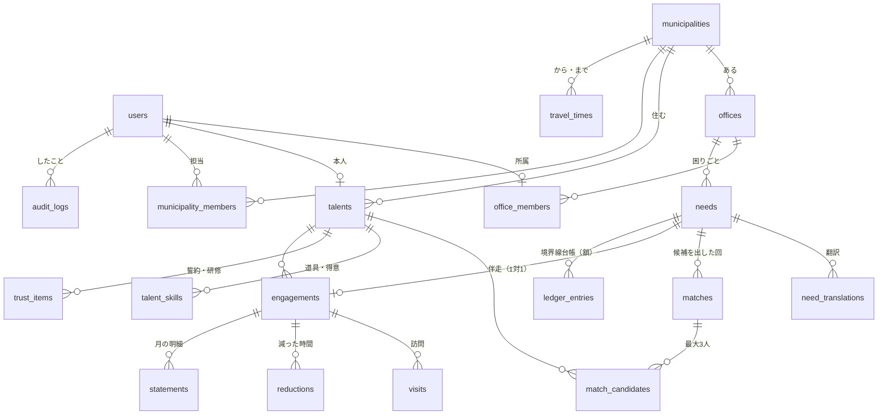
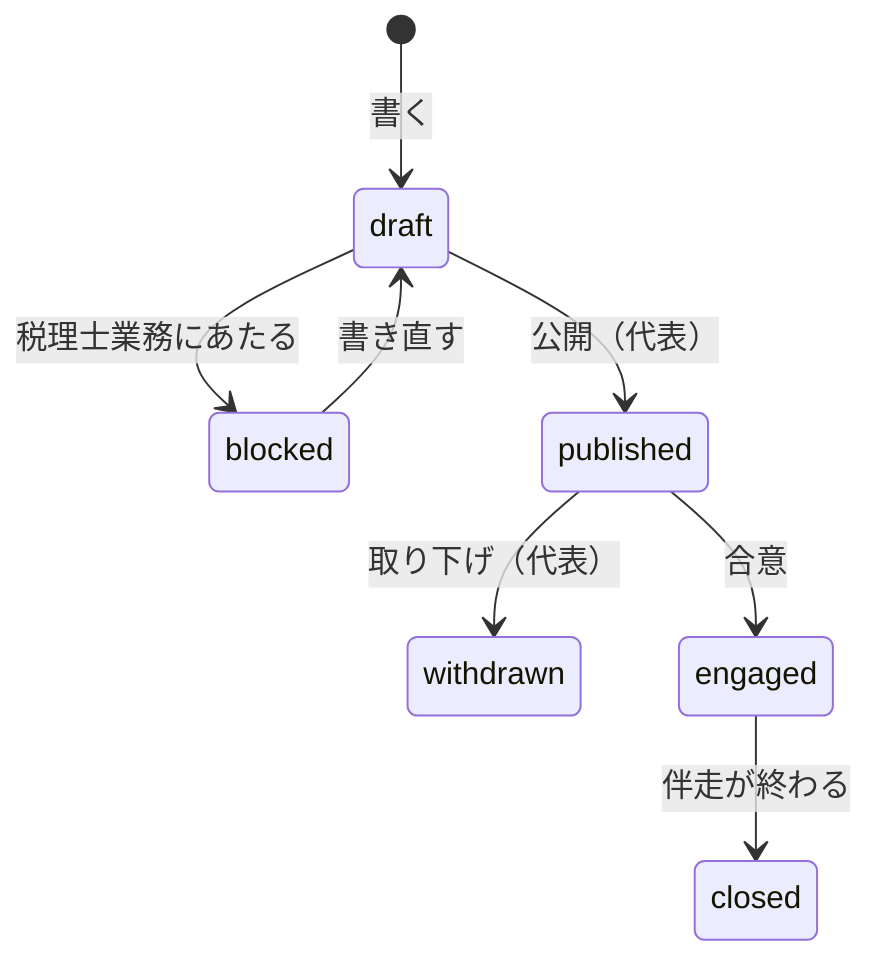

# 03｜詳細設計書 — つなぐだけ（Tsunagudake）

版2.1・2026-11-19（デモの一本道を「資料回収」1つに。§4.6 明細の「戻った先」・§5.2 の例・§11 の seed）。
機能番号（F・AC）は [01 要件定義書](01-requirements.md)、技術の決まりは [02 技術仕様書](02-technical-spec.md)、権限は [authorization.md](authorization.md)。

設計は2段で進める。**この版で詳しく決めたのは、段階0〜9（P0）で使うもの。** P1・P2 のテーブルは、その段階に入る前に、この文書に足してから作る。

---

## 1. 用語

| 言葉 | テーブル・値 | 意味 |
|---|---|---|
| 事務所 | `offices` | 会計事務所。**データを分ける単位** |
| 代表・職員 | `office_members.member_role` = `owner`／`staff` | 事務所の人。公開・声かけ・確定は代表だけ |
| つなぎ手 | `talents` | 会計とITの両方がわかり、週1回、事務所に通う人 |
| 信用台帳 | `talents`・`talent_skills`・`trust_items` | つなぎ手の級・道具・誓約・研修・実績 |
| 困りごと | `needs` | 事務所が自分の言葉で書いた、頼みたいこと |
| 翻訳 | `need_translations` | 困りごと → 会計の業務（型）→ ITの作業 |
| 候補 | `matches`・`match_candidates` | 規則で選んだ、最大3人と理由 |
| 声かけ・合意 | `match_candidates.status`・`engagements` | 代表が声をかけ、つなぎ手が受けると、伴走が始まる |
| 伴走 | `engagements` | 1つの困りごとに、1人のつなぎ手が通う関係 |
| 訪問 | `visits` | 通った日の記録。事務所が確かめる |
| 減った時間 | `reductions` | 作業の型ごとの「前」と「今」。代表が確かめる |
| 明細 | `statements` | 月の価値と料金 |
| 境界線台帳 | `ledger_entries` | 依頼・合意・変更・完了・指摘の、追記だけの記録 |
| しないこと | 台帳の `agreed` の行 | 税理士業務・顧問先の生データの持ち出し（外せない） |
| 規則 | `tsunagu_rules` | 翻訳・価値・マッチング・料金・台帳・地域の計算（§5） |

## 2. 全体の関係図



## 3. 共通ルール

| 項目 | ルール | 理由 |
|---|---|---|
| 文字コード | MySQL は `utf8mb4`・`utf8mb4_0900_ai_ci` | 日本語を正しく扱う |
| 主キー | 各テーブルに `id`（整数・自動採番） | |
| 日時 | UTC で保存。画面で日本時間にする。日付だけのもの（訪問日・月）は日本の日付で持つ | SQLite と MySQL の差を避ける |
| 金額・割合 | 円は整数。割合は万分率（bp）の整数。時間は整数（時間）。訪問だけ分 | 小数の誤差を避ける |
| 状態・種類 | VARCHAR で保存し、値は Python の Enum で制限 | DB 固有の ENUM 型を使わない |
| 作成・更新 | `created_at`。更新があるものに `updated_at` | |
| 外部キー | 必ず張る。削除の動きは §9 | |
| 変更 | Flask-Migrate のマイグレーションでだけ行う。**本番に出た後のマイグレーションファイルは書き換えない**（新しいファイルを足す） | 本番を安全に進める |
| 文章の長さ | 上限を列の型とフォームの両方で決める | MySQL は長すぎるとエラー、SQLite は通る。差を出さない |
| 個人情報 | 持つのは、メールアドレス・表示名・市町村・簿記の級まで | 01 §8 |

## 4. テーブル詳細

○＝必須。型の「文字列(n)」は VARCHAR(n)、「文章」は TEXT。

### 4.1 段階3：人と所属

**users**
| 項目 | 型 | 必須 | メモ |
|---|---|---|---|
| email | 文字列(255) | ○ | 一意。小文字にそろえて保存 |
| password_hash | 文字列(255) | ○ | 元のパスワードは保存しない |
| session_nonce | 文字列(32) | ○ | ログイン状態の世代。パスワードを変えると新しくなり、前のログインがすべて切れる |
| role | 文字列(20) | ○ | `office`／`tsunagite`／`municipality`／`admin`。**画面から変えられない** |
| display_name | 文字列(100) | ○ | 画面に出す名前 |
| is_active | 真偽 | ○ | 止めた人は、ログインできず、候補にも出ない |
| is_demo | 真偽 | ○ | デモ用のアカウント。`reset-demo` が消すのはこれだけ |
| last_login_at | 日時 | － | |

**municipalities**
| 項目 | 型 | 必須 | メモ |
|---|---|---|---|
| code | 文字列(5) | ○ | 一意。全国地方公共団体コードの5桁。**デモは 9 で始まる架空のコード** |
| name | 文字列(50) | ○ | |
| region_group | 文字列(50) | ○ | 広域の名前（匿名の基準に届かない町を、合計に入れる単位。§5.7） |

**municipality_members**：`user_id`・`municipality_id`（組で一意）。自治体の担当が、どの市町村を見られるか。

**travel_times**：`from_municipality_id`・`to_municipality_id`（組で一意）・`minutes`（車での分）。同じ市町村どうしは行を持たず、15分として扱う。行が無い組は「分からない」＝候補に出さない。

**offices**
| 項目 | 型 | 必須 | メモ |
|---|---|---|---|
| name | 文字列(100) | ○ | |
| municipality_id | 整数 | ○ | |
| hourly_rate_yen | 整数 | ○ | 事務所の時給。既定4,000円。1,000〜20,000 |
| software | 文字列(20) | － | 使っている会計ソフト（`SkillTag`） |
| is_active・is_demo | 真偽 | ○ | |

**office_members**：`office_id`・`user_id`（**user_id で一意**。1人は1つの事務所だけ）・`member_role`（`owner`／`staff`）。

### 4.2 段階3：記録

**audit_logs**（追記だけ）
| 項目 | 型 | 必須 | メモ |
|---|---|---|---|
| actor_user_id | 整数 | － | 未ログインの操作は空 |
| action | 文字列(40) | ○ | `login`・`login_failed`・`need_published`・`invited`・`agreed`・`visit_confirmed`・`statement_finalized`・`admin_viewed_office` など |
| target_type・target_id | 文字列(30)・整数 | － | |
| office_id | 整数 | － | 事務所に関わる操作 |
| ip_hash | 文字列(64) | － | IP アドレスの SHA-256（秘密の値を足してから）。元の値は保存しない |
| created_at | 日時 | ○ | |

### 4.3 段階4：困りごと

**needs**
| 項目 | 型 | 必須 | メモ |
|---|---|---|---|
| office_id | 整数 | ○ | インデックス |
| created_by | 整数 | ○ | |
| body | 文章 | ○ | 自分の言葉で。1,000文字まで。**顧問先の名前と金額を書かない**（入力欄に明記） |
| monthly_hours | 整数 | ○ | その作業に今かかっている月の時間。1〜400 |
| weekdays_mask | 整数 | ○ | 来てほしい曜日（月=1・火=2・水=4・木=8・金=16・土=32・日=64 の合計） |
| status | 文字列(20) | ○ | §6.1。初期値 `draft` |
| block_reason | 文字列(200) | － | 税理士業務にあたると判断した言葉（F11） |
| value_yen_month | 整数 | － | 公開した時点の、月の価値（時間 × 時給） |
| rules_version・input_hash | 文字列(20)・文字列(64) | － | 翻訳した規則の版と、入力のハッシュ |
| published_at・published_by | 日時・整数 | － | |

インデックス：`office_id`、`(status, published_at)`。

**need_translations**：`need_id`・`category`（`NeedCategory`）・`it_task`（`ItTask`）・`evidence`（判断に使った言葉。文字列(200)）・`source`（`rule`／`manual`／`ai_accepted`）。`(need_id, category, it_task)` で一意。翻訳し直すたびに、その困りごとの行をまとめて入れ替える（公開した後は変えない）。

**NeedCategory（会計の業務の6つの型）**
| 値 | 名前 | 例 |
|---|---|---|
| `collect` | 資料回収 | 顧問先から資料が集まらない。催促に時間がかかる |
| `check` | チェックと比較 | 帳票のチェック、過去との見比べ |
| `entry` | 入力・取り込み | 手で打っている。連携していない |
| `report` | 月次の資料づくり | 報告の資料を毎月作り直している |
| `tooling` | 道具の設定 | ソフトの設定・連携・移行 |
| `teaching` | 使い方を教える | 職員や顧問先への説明 |

**ItTask（ITの作業）**：`reminder_flow`（催促の仕組み）・`intake_form`（受け取りの入口）・`compare_sheet`（過去比較の表）・`import_rule`（取り込みの規則）・`template`（ひな形）・`api_link`（連携の設定）・`manual`（手順書）・`training`（勉強会）。型と作業の対応は辞書に持つ（§5.2）。

### 4.4 段階5：つなぎ手と信用台帳

**talents**
| 項目 | 型 | 必須 | メモ |
|---|---|---|---|
| user_id | 整数 | ○ | 一意 |
| municipality_id | 整数 | ○ | 住む市町村（住所は持たない） |
| bookkeeping_level | 文字列(10) | ○ | `none`／`3`／`2`／`1` |
| level_verified_at・level_verified_by | 日時・整数 | － | 運営が合格証を目で確かめた記録。**空なら、級は点数に数えない。画像は預からない** |
| weekdays_mask | 整数 | ○ | 通える曜日 |
| capacity | 整数 | ○ | 同時に受け持てる数。既定2。1〜5 |
| affiliation | 文字列(20) | ○ | `graduate`（修了生）／`kyoryokutai`（地域おこし協力隊）／`other`／`none` |
| is_listed | 真偽 | ○ | 候補に出てよいか（本人が止められる） |

**talent_skills**：`talent_id`・`kind`（`tool`／`strength`）・`tag`。`tool` の `tag` は `SkillTag`（`freee`・`mf`・`yayoi`・`excel`・`sheets`・`python`・`other`）、`strength` の `tag` は `NeedCategory`。組で一意。

**trust_items**（誓約と研修）
| 項目 | 型 | 必須 | メモ |
|---|---|---|---|
| talent_id | 整数 | ○ | |
| kind | 文字列(20) | ○ | `pledge`（守秘の誓約）／`training`（研修） |
| valid_from・expires_on | 日付 | ○ | `expires_on` ＝ `valid_from` ＋ 365日。**今日が期間の中にある行が1つも無ければ、候補に出ない** |
| recorded_by | 整数 | ○ | 記録した人（署名は本人。研修の確認は運営） |
| pledge_version | 文字列(20) | － | 本人が署名した守秘の誓約の版。署名画面の導入前の記録と研修では空 |

実績（F22）は列に持たない。**確かめた訪問（`visits.status = confirmed`）と、確定した明細から、その場で数える**（自己申告を数えない）。

### 4.5 段階6：候補・声かけ・合意

**matches**（候補を出した1回）：`need_id`・`rules_version`・`input_hash`・`excluded_summary`（除いた理由ごとの**人数だけ**。文章。例 `{"pledge":1,"distance":2}`）・`run_by`・`run_at`。

**match_candidates**
| 項目 | 型 | 必須 | メモ |
|---|---|---|---|
| match_id・talent_id | 整数 | ○ | 組で一意 |
| rank | 整数 | ○ | 1〜3。`(match_id, rank)` で一意 |
| score | 整数 | ○ | 0〜100 |
| reasons | 文章 | ○ | 理由の文の一覧（JSON）。規則が作った文をそのまま持つ |
| status | 文字列(20) | ○ | §6.2。初期値 `listed` |
| offer_weekday・offer_fee_share_bp・offer_fee_cap_yen | 整数 | － | 声をかけたときの条件（曜日・料金の割合・上限） |
| invited_by・invited_at・responded_at | 整数・日時 | － | |

**engagements**（伴走）
| 項目 | 型 | 必須 | メモ |
|---|---|---|---|
| office_id | 整数 | ○ | **事務所から引くために、必ず持つ** |
| need_id | 整数 | ○ | **一意**（1つの困りごとに、伴走は1つ） |
| talent_id・candidate_id | 整数 | ○ | |
| weekday | 整数 | ○ | 0（月）〜6（日） |
| hourly_rate_yen | 整数 | ○ | 合意した時点の、事務所の時給（あとで事務所の値を変えても、変わらない） |
| fee_share_bp | 整数 | ○ | 1〜4999（CHECK 制約。**半分を超えない**） |
| fee_cap_yen | 整数 | － | 月の料金の上限 |
| trial_ends_on | 日付 | ○ | 合意の日 ＋ `TRIAL_DAYS`（既定30） |
| status | 文字列(20) | ○ | §6.3 |
| agreed_at・ended_at・end_reason | 日時・日時・文字列(200) | － | |

### 4.6 段階7：訪問・減った時間・明細

**visits**
| 項目 | 型 | 必須 | メモ |
|---|---|---|---|
| engagement_id | 整数 | ○ | `(engagement_id, visit_date)` で一意 |
| visit_date | 日付 | ○ | 未来の日付は不可 |
| minutes | 整数 | ○ | 15〜600 |
| category | 文字列(20) | ○ | `NeedCategory` |
| note | 文字列(300) | － | **顧問先の名前と金額を書かない**（入力欄に明記） |
| status | 文字列(20) | ○ | `recorded` → `confirmed`／`disputed`。確かめた後は書き換えない |
| confirmed_by・confirmed_at | 整数・日時 | － | 事務所の人 |

**reductions**（月ごと・型ごと）：`engagement_id`・`month`（文字列(7)。`2026-12`）・`category`・`before_hours`・`after_hours`（0〜400）・`status`（`draft`／`confirmed`）・`confirmed_by`・`confirmed_at`。`(engagement_id, month, category)` で一意。**確かめられるのは代表だけ。**

**statements**（月の明細）
| 項目 | 型 | 必須 | メモ |
|---|---|---|---|
| engagement_id・month | 整数・文字列(7) | ○ | 組で一意（同じ月の明細は1つ） |
| reduced_hours | 整数 | ○ | 確かめた減った時間の合計 |
| hourly_rate_yen・fee_share_bp・fee_cap_yen | 整数 | ○／○／－ | 計算に使った値を**写して**持つ |
| value_yen・fee_yen | 整数 | ○ | `fee_yen` ≤ `value_yen` の半分（CHECK 制約） |
| waived | 真偽 | ○ | 減った時間が0で、0円になった |
| returned_to | 文字列(100) | － | 代表が確定のときに書く「この時間は、何に戻りましたか」（F42）。**顧問先の名前と金額を書かない**（入力欄に明記）。確定した後は書き換えない |
| rules_version | 文字列(20) | ○ | |
| status | 文字列(20) | ○ | `draft` → `finalized`。確定した後は書き換えない |
| finalized_by・finalized_at | 整数・日時 | － | 代表 |

### 4.7 段階6：境界線台帳

**ledger_entries**（追記だけ。更新・削除の処理を作らない）
| 項目 | 型 | 必須 | メモ |
|---|---|---|---|
| need_id | 整数 | ○ | 鎖の単位（1つの困りごと＝1本の鎖） |
| office_id | 整数 | ○ | 事務所から引くために持つ |
| seq | 整数 | ○ | 1から。`(need_id, seq)` で一意 |
| kind | 文字列(30) | ○ | `published`（公開）・`invited`（依頼）・`agreed`（合意）・`changed`（変更）・`visit_confirmed`・`reduction_confirmed`・`statement_finalized`（完了）・`objection`（指摘）・`ended` |
| payload | 文章 | ○ | 中身（決まった形の JSON。§5.6）。**困りごとの本文・メールアドレスは入れない** |
| prev_hash・entry_hash | 文字列(64) | ○ | 前の行のハッシュと、この行のハッシュ |
| actor_user_id | 整数 | ○ | |
| created_at | 日時 | ○ | |

### 4.8 P1 以降（要点だけ。作る前に詳しく決める）
| テーブル | 段階 | 要点 |
|---|---|---|
| rate_limit_events | 12 | `scope`・`key_hash`（相手の SHA-256）・`created_at`。1日より古い行は消す |
| invitations・password_reset_tokens | 16 | 値はハッシュで保存。期限つき・1回限り |
| outbox_mails | 16 | demo では送らず、ここに記録して運営の画面で見せる |
| totp_secrets | 17 | 2段階認証 |
| check_summaries | 18 | 過去比較の**件数だけ** |
| ai_runs | 20 | 呼んだ日時・文字数・結果。本文は残さない |
| ledger_anchors | 22 | 毎日の、鎖の最後のハッシュ（§5.6 の限界への備え） |

## 5. 規則（`tsunagu_rules`）

### 5.1 共通
- **純粋な関数**だけ。Flask も DB も時計も読まない。「今日」は引数でもらう。
- 入力と出力は `types.py` の dataclass と Enum。
- **同じ入力なら、必ず同じ出力。** 並び順も同じ（辞書の順番・同点の決め方を決めてある）。
- `RULES_VERSION = "1.0.0"`。規則か辞書を変えたら上げ、結果の行に残す。
- 既定値は `.env` で変えられる（§5.8）。関数は値を引数でもらい、`.env` を読むのはアプリ側。

### 5.2 翻訳 `translate(text, dictionary) -> Translation`（F10・F11）
1. **そろえる**：NFKC（全角と半角をそろえる）→ 小文字 → 空白と改行を取る。
2. **税理士業務の見分け（先に見る）**：辞書の `taxwork` の言葉（例：「申告書の作成」「税務相談」「節税の提案」「税務調査の立ち会い」「税額の計算」「税務署への提出の代理」）が1つでも入っていれば、`blocked=True`、当たった言葉を理由に返す。**ここで止まり、型は返さない。**
3. **型を当てる**：型ごとの言葉（例：`collect`＝「集まらない」「催促」「回収」「届かない」「取りに行」「打ち直」、`check`＝「チェック」「見比べ」「比較」「確認に時間」）が入っていれば、その型と、当たった言葉（根拠）を返す。
4. **作業を当てる**：型 → ITの作業は、辞書の対応表で決める（例：`collect` → `reminder_flow`・`intake_form`、`check` → `compare_sheet`）。
5. どの型にも当たらなければ `matched=False`。画面は「規則では訳せませんでした。型を選んでください」と出し、人が選ぶ（`source=manual`）。
6. 返す順番は、型の定義の順。`input_hash` ＝ SHA-256（そろえた文章 ＋ 辞書の版）。

見分けは**安全側に倒す**（迷う言葉は止める）。止められた事務所は、言い方を変えて書き直せる。辞書の言葉は、実際の事務所の言い方を聞いて足す（版を上げる）。

### 5.3 価値 `estimate_value(monthly_hours, hourly_rate_yen) -> ValueEstimate`（F12）
- 月の価値 ＝ `monthly_hours × hourly_rate_yen`。
- 減らせる見込みは3段：少なめ20%・真ん中35%・多め50%（時間は切り捨て）。**見込みであって、約束ではない**と画面に書く。
- 例：30時間 × 4,000円 ＝ 120,000円。見込みは 6・10・15時間 ＝ 24,000・40,000・60,000円。

### 5.4 マッチング `match(need, talents, travel, today, limits) -> MatchResult`（F25・F26）

**① 必須条件（1つでも外れたら、候補に出さない）**
| # | 条件 | 除いた理由の名前 |
|---|---|---|
| M1 | 守秘の誓約が、今日有効 | `pledge` |
| M2 | 研修が、今日有効 | `training` |
| M3 | 事務所の市町村まで、車で `TRAVEL_LIMIT_MINUTES`（60）分以内。分からない組は除く | `distance` |
| M4 | 来てほしい曜日と、通える曜日が1日以上重なる | `weekday` |
| M5 | 受け持ち中の伴走が、上限より少ない | `capacity` |
| M6 | 候補に出てよい（`is_listed`）・止められていない | `unlisted` |
| M7 | この困りごとで、すでに断っていない | `declined` |

**② 点数（100点満点）**
| 項目 | 点 | 理由の文（例） |
|---|---|---|
| 簿記の級（**確かめた級だけ**） | 2級以上30／3級18／なし・未確認0 | 「簿記2級：会計の言葉が通じます」 |
| 道具（事務所のソフトを使える） | 20 | 「同じ会計ソフトを使えます」 |
| 得意（困りごとの型と重なる） | 1つ10、最大20 | 「資料回収の仕組みづくりが得意です」 |
| 距離 | 15分以内15／30分以内10／45分以内5／60分以内2 | 「車で25分：毎週通える距離です」 |
| 実績（事務所が確かめた訪問） | 12回以上10／4回以上6／1回以上3／0回0 | 「確かめられた訪問が8回あります」 |
| 曜日の重なり | 2日以上5／1日3 | 「火曜に通えます」 |

**③ 並べ方**：点数の高い順 → 移動の分が短い順 → 確かめた訪問が多い順 → `talent_id` の小さい順。**上位3人**を返す。
**④ 理由**：0点でない項目の文を、上の表の順に並べる。
**⑤ 除いた人**：名前は返さず、理由ごとの**人数だけ**を返す。

決めてあること：実績の配点は10点まで（始めたばかりの人が、ずっと選ばれない仕組みにしない）。点数は画面に出すが、**選ぶのは代表**。候補が0人のときは「条件に合う人が、今はいません」と、除いた理由の人数を出す。

### 5.5 料金 `calc_fee(reductions, hourly_rate_yen, fee_share_bp, fee_cap_yen) -> Fee`（F40・F41）
```
reduced = Σ max(0, before_hours − after_hours)      # 確かめた行だけ。増えた型は0として数える
value   = reduced × hourly_rate_yen
fee     = value × fee_share_bp // 10000              # 切り捨て
fee     = min(fee, fee_cap_yen)                      # 上限があれば
waived  = (reduced == 0)                             # このとき fee = 0
```
- `fee_share_bp` は 1〜`FEE_SHARE_MAX_BP`（4999）。外れた値は、計算せずにエラー（半分を超えない、を規則で守る）。
- 例：20時間 × 4,000円 ＝ 80,000円。40%で 32,000円。減った時間が0なら 0円。

### 5.6 台帳 `append(prev_hash, entry) -> entry_hash`・`verify(entries) -> VerifyResult`（F32〜F34）
- 中身の形：`{"actor":…, "at":"UTC の ISO 形式（秒まで）", "data":{…}, "kind":…, "need":…, "rules":…, "seq":…}`。キーを並べ替え、空白なしの JSON にする（同じ中身なら、必ず同じ文字列）。
- `entry_hash` ＝ SHA-256（`prev_hash` ＋ 改行 ＋ その JSON）。最初の行の `prev_hash` は `0` を64個。
- `agreed` の `data` には、**外せない「しないこと」**が必ず入る：`["税理士業務（税務代理・税務書類の作成・税務相談）", "顧問先の生データの持ち出し"]`。規則の定数で、画面から消せない。足すことはできる。
- `verify`：1行ずつ計算し直し、合わない最初の `seq` を返す。

**限界（正直に書く）**：ハッシュの鎖で見つかるのは、**途中の行の書き換え**。DB を丸ごと書き換えられる人が、鎖を最後まで作り直すことは防げない。備えは段階22：毎日、鎖の最後のハッシュを、DB の外（バックアップの置き場所と、双方へのメール）に控える。

### 5.7 地域 `mask_region(rows, k) -> RegionView`（F55）
入力は、市町村ごとの集計（参加事務所の数・つなぎ手の数・うち協力隊など・訪問の回数・確かめた減った時間）。名前のある行は受け取らない。
1. 参加事務所の数が1以上 `k`（5）未満の市町村は、**その市町村の数字をすべて伏せる**。
2. 数が1以上 `k` 未満のマスも伏せる（0はそのまま出す）。
3. 広域の合計は、①合計の事務所が `k` 以上で、②伏せた市町村が**ちょうど1つではない**ときだけ出す（合計から見えている町を引くと、伏せた町が分かってしまうため）。
4. 伏せたマスは `None` で返し、画面は「―（少ないため表示しません）」と出す。

### 5.8 既定値
| 名前（`.env`） | 既定 | 使う所 |
|---|---|---|
| `DEFAULT_HOURLY_RATE_YEN` | 4000 | 事務所の時給の初期値 |
| `DEFAULT_FEE_SHARE_BP` | 4000 | 声をかけるときの、料金の割合の初期値 |
| `FEE_SHARE_MAX_BP` | 4999 | 料金の割合の上限 |
| `TRAVEL_LIMIT_MINUTES` | 60 | M3 |
| `TRIAL_DAYS` | 30 | お試しの長さ |
| `PLEDGE_VALID_DAYS` | 365 | 誓約と研修の期限 |
| `REGION_K_ANONYMITY` | 5 | 匿名の基準。5以上 |

## 6. 状態と遷移

### 6.1 困りごと（`needs.status`）

`draft`・`blocked` の間だけ本文を直せる。`published` 以降は直せない（直すなら取り下げて書き直す）。

### 6.2 候補（`match_candidates.status`）
`listed` →（代表が声をかける）→ `invited` →（つなぎ手）→ `accepted`／`declined`。
同じ困りごとで、同時に `invited` にできるのは1人だけ。`accepted` になったら、残りは `closed`。14日答えが無ければ `expired`（P2。それまでは代表が取り消せる）。

### 6.3 伴走（`engagements.status`）
`trial`（お試し）→ `active`（お試しの後も続ける。代表が決める）→ `ended`。`trial`・`active` から、どちらからでも `ended` にできる（理由を台帳に残す）。

### 6.4 訪問・減った時間・明細
| もの | 遷移 | 誰が |
|---|---|---|
| 訪問 | `recorded` → `confirmed`／`disputed` | 記録はつなぎ手、確かめるのは事務所の人 |
| 減った時間 | `draft` → `confirmed` | 入れるのは事務所の人、確かめるのは代表 |
| 明細 | `draft` → `finalized` | 代表だけ。その月の減った時間がすべて `confirmed` のときだけ |

確かめた・確定した後は、書き換えない。違っていたら、台帳に `objection`（指摘）を足し、翌月の明細で直す。

## 7. 同時の操作への備え

- 状態を変える処理は、`app/services/` の1つの関数＝1つのトランザクション。
- 最初に**親の行をロック**する（`with_for_update()`。困りごとに関わる操作は `needs` の行、伴走に関わる操作は `engagements` の行）。ロックの後で状態を読み直し、期待どおりのときだけ進む。
- 最後の守りは一意制約：`engagements.need_id`（伴走は1つ）、`(engagement_id, month)`（明細は1つ）、`(need_id, seq)`（台帳の番号）、`(engagement_id, visit_date)`。ぶつかったら、やり直さずに「すでに処理されています」と返す。
- 台帳の追記：`needs` の行をロック → 最後の `seq` と `entry_hash` を読む → 次の行を足す。
- SQLite は行のロックが効かない（書けるのが1人だけ）。**同時の操作のテストは MySQL で動かす**（02 §10.3）。
- 制約にぶつかったときの例外は、DB で種類が違う（MySQL の CHECK 制約は `OperationalError`）。`services` は `sqlalchemy.exc.DBAPIError` をまとめて受け、巻き戻して、決まった文言を返す（02 §6）。

| 起こりうること | 結果 |
|---|---|
| 代表が2人に同時に声をかける | 片方だけ成立 |
| つなぎ手の「受ける」と、代表の「取り消す」が同時 | 先に届いた方だけ成立 |
| 明細の確定を2回押す | 1回だけ成立。台帳の行も1つ |
| 訪問を確かめるのと、つなぎ手が直すのが同時 | 確かめた後は直せない |

## 8. ルートと画面

「誰」の詳しい表は [authorization.md](authorization.md)。状態を変えるのは POST だけ。

| 方法 | パス | すること | 呼ぶもの | 段階 |
|---|---|---|---|---|
| GET | `/` | 一言・しくみ・（demo）デモで入る | — | 0・9 |
| GET | `/how` | 規則の中身を全部見せる（必須条件・点数の表・料金の式・しないこと） | `tsunagu_rules` の定数 | 9 |
| GET | `/healthz` | DB に `SELECT 1`。`ok` だけ返す | — | 0 |
| GET・POST | `/login`・POST `/logout` | ログイン | `services/auth` | 3 |
| POST | `/demo/enter` | 立場を選んで、デモのアカウントで入る（demo・development だけ） | `services/demo` | 9 |
| GET | `/o/<office_id>/` | 事務所のホーム（困りごと・伴走の一覧） | — | 4 |
| GET・POST | `/o/<office_id>/needs/new` | 困りごとを書く → 翻訳して下書きに | `translate`・`estimate_value` | 4 |
| GET | `/o/<office_id>/needs/<id>` | 翻訳・根拠の言葉・月の価値・止めた理由 | — | 4 |
| POST | `/o/<office_id>/needs/<id>/publish`・`/withdraw` | 公開・取り下げ | `services/needs` | 4 |
| GET | `/o/<office_id>/needs/<id>/candidates` | 候補3人と理由・除いた人数 | `match` | 6 |
| POST | `/o/<office_id>/needs/<id>/candidates/<cid>/invite` | 声をかける（曜日・割合・上限） | `services/matching` | 6 |
| GET | `/o/<office_id>/engagements/<id>` | 訪問・減った時間・明細・台帳 | — | 7 |
| POST | `/o/<office_id>/engagements/<id>/visits/<vid>/confirm` | 訪問を確かめる | `services/visits` | 7 |
| POST | `/o/<office_id>/engagements/<id>/reductions` | 減った時間を入れる・確かめる | `services/reductions` | 7 |
| POST | `/o/<office_id>/engagements/<id>/statements/<month>/finalize` | 明細を確定 | `calc_fee`・`services/statements` | 7 |
| GET | `/t/` | つなぎ手のホーム（信用台帳・声かけ・伴走） | — | 5 |
| POST | `/t/invitations/<cid>/accept`・`/decline` | 受ける・断る（受けると伴走ができ、台帳に合意が残る） | `services/matching` | 6 |
| GET・POST | `/t/engagements/<id>/visits/new` | 訪問を記録 | `services/visits` | 7 |
| GET | `/r/<municipality_code>/` | 地域のダッシュボード | `mask_region` | 8 |
| GET | `/admin/` ほか | 人・級の確認・台帳の検証 | — | 13 |

コマンド：`flask create-user`（3。パスワードは対話で聞く）・`flask verify-ledger`（6）・`flask seed-demo`・`flask reset-demo --yes`（9）。

画面の決まり（02 §8）：候補・訪問・明細・台帳・地域は**表**。1画面に主のボタンは1つ。押せないボタンには、理由を1行。

## 9. 削除したときの動き（F80・P2）

発表までは、消すのはデモのデータだけ（`reset-demo` は `is_demo` のものだけを消す）。実際の退会は段階23で作る。先に決めてあること：

| もの | 退会のとき |
|---|---|
| users | 行は残し、メールアドレスと表示名を消す（`退会した人`）。ログインできなくする。**台帳と明細が指しているので、行ごとは消さない** |
| talents・talent_skills・trust_items | 消す |
| 事務所の退会：needs の本文・visits のメモ | 消す（空にする） |
| engagements・statements（金額・月・状態） | 残す（相手の記録でもある） |
| ledger_entries | **消さない。** 中身に個人情報を入れない設計（§4.7）なので、残しても個人は分からない |
| audit_logs | 残す。`ip_hash` は180日で消す |
| 条件 | 進行中の伴走・確定していない明細がある間は、退会できない |

## 10. テスト

★＝発表までに通す（P0）。境界の値を必ず入れる。

### 10.1 規則（`tests/rules/`。DB なし）
| # | 確かめること | AC |
|---|---|---|
| T01★ | 同じ文章を2回訳すと、結果も `input_hash` も同じ。全角・半角・空白が違っても同じ | AC01 |
| T02★ | 「資料が集まらない」→ `collect`、根拠の言葉つき。2つの型にまたがる文章は、定義の順で両方 | AC01 |
| T03★ | 「申告書の作成」「税務相談」が入る文章は `blocked`。型は返らない | AC02 |
| T04★ | どの言葉にも当たらない文章は `matched=False` | AC01 |
| T05★ | 誓約が昨日切れた人は出ない。今日が期限の日の人は出る | AC03 |
| T06★ | 60分ちょうどは出る。61分は出ない。移動時間が分からない組は出ない | AC03 |
| T07★ | 曜日が重ならない人・上限いっぱいの人・断った人は出ない | AC03 |
| T08★ | 4人が条件を満たすと、返るのは3人。同点は、分 → 訪問 → id の順 | AC04 |
| T09★ | 未確認の級は0点。理由の文は、0点でない項目だけ、決まった順 | AC04 |
| T10★ | 除いた人は、理由ごとの人数だけが返る（名前・id が無い） | AC04 |
| T11★ | 20時間・4,000円・4000bp → 32,000円。0時間 → 0円・`waived` | AC05 |
| T12★ | 増えた型は0として数える。上限があれば上限まで。端数は切り捨て | AC05 |
| T13★ | 割合が0・5000・負の数は、計算せずエラー | AC05 |
| T14★ | 行を足すと鎖がつながる。途中の行を1文字変えると、その `seq` で見つかる | AC08 |
| T15★ | 合意の中身から「しないこと」の2つを外せない | AC08 |
| T16★ | 事務所4つの町は全部伏せる。5つの町は出る。0はそのまま出る | AC09 |
| T17★ | 伏せた町がちょうど1つの広域は、合計も伏せる | AC09 |

### 10.2 アプリ（`tests/app/`）
| # | 確かめること | AC |
|---|---|---|
| T20★ | 未ログインで事務所・つなぎ手・地域の画面を開くと、ログインへ | AC06 |
| T21★ | 他の事務所の困りごと・候補・伴走・明細は 404。一覧にも出ない（[authorization.md](authorization.md) の拒否のマスごとに1本） | AC06 |
| T22★ | 職員が公開・声かけ・確定をすると 403 | AC07 |
| T23★ | つなぎ手は、自分の伴走だけ見える。声をかけられる前は、困りごとの本文が見えない | AC06 |
| T24★ | 自治体の担当は、自分の市町村だけ。画面に事務所名・人名が1つも無い | AC09 |
| T25★ | `blocked` の困りごとは公開できない | AC02 |
| T26★ | 受けると、伴走が1つでき、台帳に `agreed` が「しないこと」つきで1行増える | AC08 |
| T27★ | 確かめていない減った時間がある月は、確定できない。確定を2回押しても、明細も台帳も1つ | AC05 |
| T28★ | 確かめた訪問・確定した明細は、書き換えられない | AC08 |
| T29★ | production では `/demo/enter` が 404。`seed-demo`・`reset-demo` が動かない | AC10 |
| T30★ | 鍵が空・SQLite・http の設定で、demo・production は起動しない | AC11 |
| T31★ | `theme.css` の色の組み合わせのコントラストが、すべて 4.5 以上 | — |
| T32★ | `/healthz` が 200。応答に CSP などのヘッダーが付く。知らない Host は 400 | AC11 |
| T33 | 同時に2人へ声をかけても、成立は1人（MySQL） | — |
| T34 | ログインの失敗が15分に5回で 429。登録の有無で文言が変わらない | — |
| T35 | バックアップから別の DB に戻し、件数が合う（手順書の確かめ） | AC13 |

## 11. デモのデータ（`flask seed-demo`）

**すべて架空。** 実在の事務所・人・町・数字を入れない。デモのアカウントは `is_demo`。パスワードは `.env` の `DEMO_PASSWORD`（画面・README・スライドに書かない。入口は「デモで入る」のボタン）。

| もの | 中身 |
|---|---|
| 市町村 | 「みなみ市」（90001）・「きた町」（90002）・「ひがし村」（90003）。広域は「架空広域」。移動時間の表つき |
| 事務所 | みなみ市に6つ、きた町に2つ（＝数字が出る町と、伏せられる町の両方を見せる） |
| つなぎ手 | 8人。うち1人は誓約切れ、1人は70分かかる、1人は曜日が合わない、1人は上限いっぱい（＝「最初から出ない」を見せる）。級・道具・所属はばらばら。**規則の結果として、上位3人に所属「協力隊」の人と、得意「資料回収の仕組みづくり」の人が入るよう、値を置く**（規則は曲げない） |
| 困りごと | 台本の1件（下書き。「顧問先の紙の帳簿を、毎月こちらから取りに行っている。持ち帰ってパソコンに打ち直す。写真で受け取りたいが、仕組みがない。資料回収に毎月30時間かかる」。**`collect` だけに当たり、`check` には当たらない**）と、止められる例1件（「申告書の作成も頼みたい」） |
| 進んだ例 | 伴走中の1件（訪問4回を確かめ済み。減った時間20時間。明細は確定の手前。確定のとき `returned_to` に「顧問先の相談に戻った」と書く場面を見せる）。ほかの事務所に、確定済みの明細を数件（地域の数字のもと） |
| 立場 | 「会計事務所として見る」（代表）・「つなぎ手として見る」・「自治体として見る」（みなみ市の担当） |

`reset-demo --yes` は、`is_demo` のものを消して入れ直す。発表の直前に1回動かす。

## 12. 作る順番

### 12.1 段階
1つの段階＝1つの Issue。**1つずつ進め、終えるたびに `make check` を通してコミットする。**

| 段階 | 作るもの | 機能 | 優先度 |
|---|---|---|---|
| 0 | 開発の土台：uv・Flask の骨組み・4つの設定・起動時の検査・`/healthz`・`theme.css`・`make check`・CI・AGENTS.md | F65 | P0 |
| 1 | 公開の土台：VPS・MySQL・nginx・gunicorn・systemd・HTTPS。**空のアプリを先に出す** | AC12 | P0 |
| 2 | 規則：`translate`・`estimate_value`・`match`・`calc_fee`・`ledger`・`mask_region` と T01〜T17 | F10〜F12・F25・F26・F32・F40・F41・F55 | P0 |
| 3 | 人と所属：テーブル・ログイン・`create-user`・権限の土台（事務所から引く）・監査記録 | F01〜F03・F07 | P0 |
| 4 | 困りごと：書く・翻訳・価値・止める・公開 | F10〜F13 | P0 |
| 5 | つなぎ手と信用台帳：テーブル・ホーム（表示） | F20〜F22 | P0 |
| 6 | 候補・声かけ・合意・境界線台帳・`verify-ledger` | F25〜F28・F32〜F34 | P0 |
| 7 | 訪問・減った時間・明細 | F30・F31・F40〜F42 | P0 |
| 8 | 地域のダッシュボード | F55 | P0 |
| 9 | デモ：上部の表示・`seed-demo`・`reset-demo`・デモで入る・しくみのページ・通し稽古 | F60〜F62 | P0 |
| 10 | バックアップと、復元の練習 | F66 | P1 |
| 11 | 自動デプロイ | F67 | P1 |
| 12 | 回数制限 | F06 | P1 |
| 13 | つなぎ手の編集・誓約の署名・運営の画面（級の確認） | F20・F21・F23 | P1 |
| 14 | 見た目と文言の点検（状態・スマホ・`ja-checker`） | 02 §8 | P1 |
| 15 | 権限の点検（`authz-checker`・拒否のマスの総ざらい） | F02 | P1 |
| 16 | 招待・パスワード再設定・通知メール | F03・F04・F70 | P2 |
| 17 | 2段階認証 | F05 | P2 |
| 18 | 過去比較チェック（事務所の PC で動く道具） | F45 | P2 |
| 19 | 資料回収ボード・撮って送るだけ帳簿との連携 | F46・F50 | P2 |
| 20 | AI による翻訳の候補 | F91 | P2 |
| 21 | 開発用の MCP サーバー | F90 | P2 |
| 22 | 台帳の毎日の検証と、外への控え | F34 | P2 |
| 23 | 退会と削除・プライバシーポリシー | F80 | P2 |

段階1を早く置く理由：公開でつまずくのは、機能ではなく、契約・DNS・証明書の待ち時間。**先に空のアプリを出しておけば、あとは push するだけになる。**

### 12.2 間に合わないときに削る順番（先に決めておく）
上から順に削る。**下の3つは削らない。**

| 順 | 削るもの | 代わり |
|---|---|---|
| 1 | 運営の画面 | コマンドと seed |
| 2 | 訪問を記録する画面 | seed で入れておき、「確かめる」だけ見せる |
| 3 | つなぎ手のホームの作り込み | 「受ける」の1画面だけ |
| 4 | 公開した URL | 手元の PC で動かして見せる。念のため、通しの録画を持つ |
| 5 | 地域のダッシュボードの広域の合計 | 市町村の表と、伏せ字だけ |
| ― | **削らない①** 規則とそのテスト（T01〜T17） | これが Python で作った中身 |
| ― | **削らない②** 困りごと → 翻訳 → 候補と理由 → 明細、の一本道 | 台本の骨 |
| ― | **削らない③** 合意で「しないこと」が台帳に残ること | 思想そのもの |

### 12.3 発表までの置き方（2026-11-22）
| 日 | やること | 終わりの目安 |
|---|---|---|
| 11-19（木）夜 | VPS の申し込みと、ドメインの向き先（待ち時間があるものを先に） | 30分 |
| 11-20（金） | 段階0・1・2・3 | `/healthz` が公開の URL で 200。規則のテストが全部通る。ログインできる |
| 11-21（土） | 段階4〜9。**21時に機能を止める**（その後は直すだけ） | 台本を手元で通せる |
| 11-22（日）朝 | `reset-demo`・スマホで通し稽古2回・録画 | AC12 |

## 13. 未決

| # | 決めること | 仮の置き方 |
|---|---|---|
| D1 | お試しの後の「減らなければ0円」（01 §12.2 Q8） | 式は同じ。お試しの後の扱いは、専門家に確かめてから |
| D2 | 時間を「時間」の整数で持つので足りるか（30分単位の声が出るか） | 整数。声が出たら分に変える（マイグレーション） |
| D3 | 候補が0人のとき、条件をゆるめる案を出すか | 出さない（必須条件は守りなので、ゆるめない） |
| D4 | 市町村の間の移動時間の出どころ（02 §14 U5） | デモは架空の表 |
| D5 | 訪問の「違う」（`disputed`）の後の流れ | 台帳に指摘を残し、話し合いはアプリの外 |
